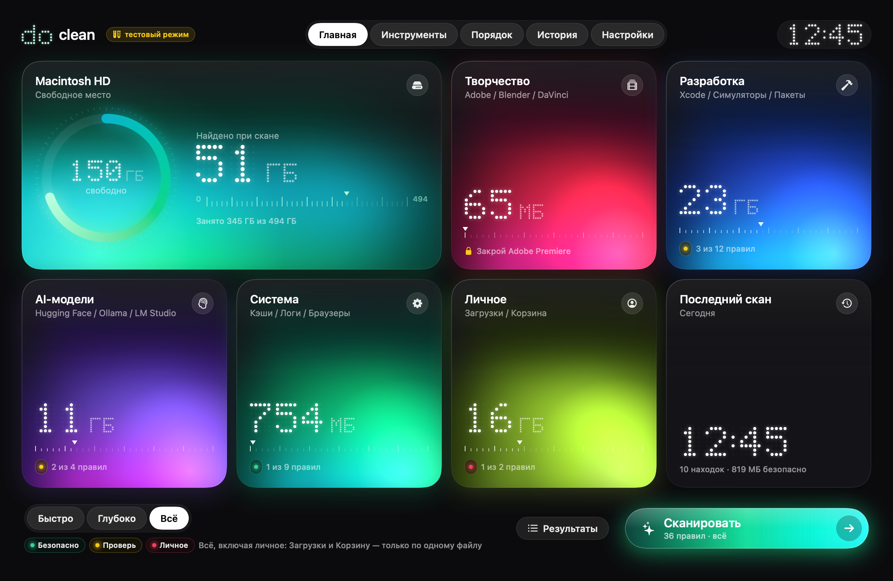
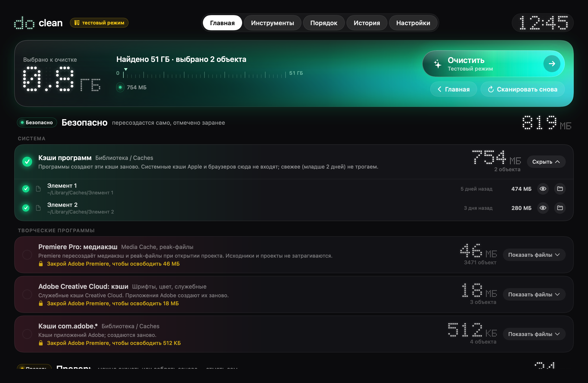
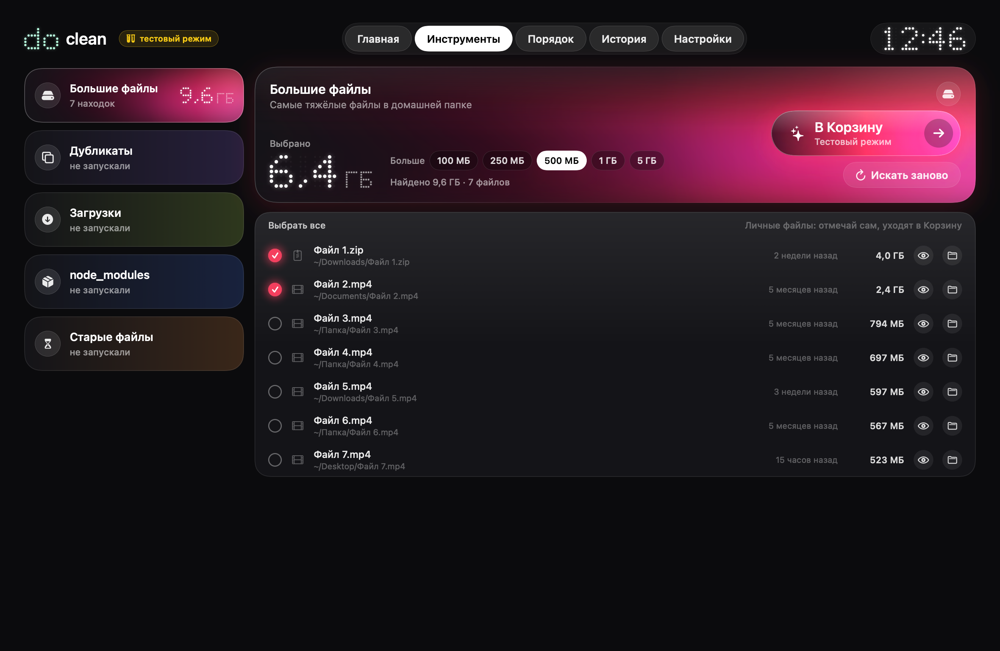

# do clean

**RU** · [EN](#english)

Красивый и безопасный чистильщик для macOS. Показывает, **что** удаляется, **почему** это безопасно и **сколько** места вернётся.
Знает про тяжёлый мусор творческих и dev-машин: Adobe (After Effects, Premiere, Media Encoder), Xcode, Blender, AI-модели.

| Главная | Результаты | Инструменты |
|---|---|---|
|  |  |  |

<!-- Сюда можно добавить ещё: docs/screens/scanning.png, finished.png -->

## Три уровня безопасности

| Уровень | Что это | По умолчанию | Как удаляется |
|---|---|---|---|
| 🟢 **Безопасно** | Кэши, логи, временные файлы, DerivedData: программы создают их заново | отмечено | сразу (или в Корзину, если так выбрано в Настройках) |
| 🟡 **Проверь** | Можно удалить, но придётся скачать или пересобрать: DeviceSupport, симуляторы, AI-модели, кэши пакетных менеджеров, Корзина | не отмечено | в Корзину (кроме самой Корзины) |
| 🔴 **Личное** | Твои файлы: Загрузки, большие и старые файлы, дубликаты | только выбор по файлам | в Корзину, всегда со списком файлов |

Режимы: **Быстро** (зелёный), **Глубоко** (зелёный и жёлтый), **Всё** (все три).

## Установка из DMG

1. Скачай `doclean-<версия>.dmg`, открой его и перетащи **do clean** в **Программы**.
2. Первый запуск: см. ниже, приложение не подписано Developer ID.
3. Выдай **Full Disk Access** (см. ниже).

Контрольная сумма лежит рядом: `doclean-<версия>.dmg.sha256` (`shasum -a 256 -c doclean-<версия>.dmg.sha256`).

### Первый запуск без Developer ID

Подписи Apple Developer ID нет, поэтому macOS скажет «не удалось проверить разработчика». Два способа:

- **Правый клик на приложении → Открыть → Открыть.** Достаточно один раз.
- Или в Терминале:

```bash
xattr -dr com.apple.quarantine "/Applications/do clean.app"
```

### Full Disk Access

Приложению нужен доступ к чужим кэшам, поэтому оно работает без песочницы и просит **Full Disk Access**:
*Системные настройки → Конфиденциальность и безопасность → Полный доступ к диску → включить «do clean»*.
Онбординг откроет нужную панель и сам заметит, когда доступ выдан. Без него часть кэшей (Safari, Почта) не видна.

## Что мы никогда не трогаем

Жёстко зашито в коде (`SafetyGuard`) и не настраивается:

- `~/Documents`, `~/Desktop`, `~/Pictures`, медиатеки Фото, iCloud Drive (`Mobile Documents`): кроме инструментов «Большие файлы», «Старые файлы» и «Дубликаты», где только предпросмотр и **Корзина**
- Keychains, профили браузеров, пароли, `~/Library/Application Support` (кроме нескольких явно названных кэшей Adobe), `.ssh`, `.gnupg`, `.aws`
- Системные папки `/System`, `/usr`, `/Library`, `/Applications`
- Файлы программ, которые запущены прямо сейчас: правило пропускается, а приложение подсказывает «закрой After Effects, чтобы освободить 46 ГБ»
- Всё, что изменилось после сканирования; симлинки, ведущие за пределы правила

Перед удалением каждый путь проходит проверку, это покрыто тестами. Сначала всегда можно сделать **пробный прогон** (dry run).

## Свои правила

Кэши своих программ и плагинов можно добавить, не трогая код. Положи JSON в
`~/Library/Application Support/do clean/Rules/*.json`. Формат тот же, что у встроенных
правил в `Sources/DoCleanCore/Rules`, `id` должен быть новым. Эти правила видишь только ты,
и они проходят ту же проверку SafetyGuard.

## Командная строка

```bash
doclean scan --tier all --json        # что найдено (только чтение)
doclean clean --dry-run               # план очистки зелёного уровня, ничего не удаляется
doclean tools large|dupes|downloads|old --json
```

## Сборка из исходников

Нужны macOS 14+ и Xcode / Swift 6.

```bash
Tools/test.sh        # тесты (на фейковой файловой системе)
Tools/bundle.sh      # build/do clean.app (ad-hoc подпись)
Tools/release.sh     # dist/doclean-<версия>.dmg + .sha256
```

Подробности: [docs/SPEC.md](docs/SPEC.md), [docs/CORE_API.md](docs/CORE_API.md).

---

## English

A beautiful, honest and safe cleaner for macOS. It shows **what** gets removed, **why** that is safe and **how much** space comes back.
It knows the heavy junk of creative and dev machines: Adobe (After Effects, Premiere, Media Encoder), Xcode, Blender, AI models.


### Three safety tiers

| Tier | What | Default | Removal |
|---|---|---|---|
| 🟢 **Safe** | Caches, logs, temp files, DerivedData: apps rebuild them | selected | immediately (or to the Trash, if you choose so in Settings) |
| 🟡 **Review** | Removable, but must be re-downloaded or rebuilt: DeviceSupport, simulators, AI models, package-manager caches, the Trash | not selected | to the Trash (except the Trash itself) |
| 🔴 **Personal** | Your files: Downloads, large and old files, duplicates | file by file | to the Trash, always with a file list |

Modes: **Quick** (green), **Deep** (green + yellow), **Everything** (all three).

### Install from the DMG

1. Download `doclean-<version>.dmg`, open it and drag **do clean** into **Applications**.
2. First launch: see below, the app is not signed with a Developer ID.
3. Grant **Full Disk Access** (see below).

The checksum is next to it: `doclean-<version>.dmg.sha256` (`shasum -a 256 -c doclean-<version>.dmg.sha256`).

#### First launch without a Developer ID

There is no Apple Developer ID signature, so macOS says it "cannot verify the developer". Two ways around it:

- **Right-click the app → Open → Open.** Once is enough.
- Or in Terminal:

```bash
xattr -dr com.apple.quarantine "/Applications/do clean.app"
```

#### Full Disk Access

The app reads other apps' caches, so it runs without the App Sandbox and asks for **Full Disk Access**:
*System Settings → Privacy & Security → Full Disk Access → enable "do clean"*.
Onboarding opens the right pane and notices when access is granted. Without it some caches (Safari, Mail) stay invisible.

### What it never touches

Hard-coded in `SafetyGuard`, not configurable:

- `~/Documents`, `~/Desktop`, `~/Pictures`, Photos libraries, iCloud Drive: except the Large files, Old files and Duplicates tools, which only preview and move to the **Trash**
- Keychains, browser profiles and passwords, `~/Library/Application Support` (apart from a few named Adobe caches), `.ssh`, `.gnupg`, `.aws`
- System folders `/System`, `/usr`, `/Library`, `/Applications`
- Files of apps that are running right now: the rule is skipped and the app says "Close After Effects to free 46 GB"
- Anything modified after the scan; symlinks that lead outside a rule's folder

Every path is validated right before removal, and this is covered by tests. A **dry run** is always available first.

### Custom rules

Add caches of your own apps or plugins without touching the code: drop a JSON file into
`~/Library/Application Support/do clean/Rules/*.json`. It uses the same format as the bundled
rules in `Sources/DoCleanCore/Rules` and needs a new `id`. These rules stay on your Mac and go
through the same SafetyGuard checks.

### Command line

```bash
doclean scan --tier all --json
doclean clean --dry-run
doclean tools large|dupes|downloads|old --json
```

### Build from source

Requires macOS 14+ and Xcode / Swift 6.

```bash
Tools/test.sh        # tests (on a fake file system)
Tools/bundle.sh      # build/do clean.app (ad-hoc signature)
Tools/release.sh     # dist/doclean-<version>.dmg + .sha256
```

See [docs/SPEC.md](docs/SPEC.md) (RU) and [docs/CORE_API.md](docs/CORE_API.md).
